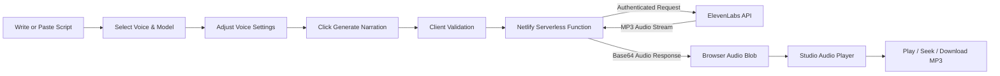

# ElevenNarrate

> **Turn written words into natural voice.**

ElevenNarrate is a modern, studio-grade AI Text-to-Speech (TTS) web application powered by the ElevenLabs API and Netlify Serverless Functions. Designed with a calm, elegant digital audio studio aesthetic, ElevenNarrate transforms scripts into lifelike voice narrations with real-time vocal shaping, native playback controls, and high-fidelity MP3 downloads.

---

## Table of Contents

1. [Features](#features)
2. [User Workflow](#user-workflow)
3. [Project Structure](#project-structure)
4. [Technologies Used](#technologies-used)
5. [Prerequisites](#prerequisites)
6. [Obtaining an ElevenLabs API Key](#obtaining-an-elevenlabs-api-key)
7. [Finding Valid ElevenLabs Voice IDs](#finding-valid-elevenlabs-voice-ids)
8. [Configuring Voices and Models](#configuring-voices-and-models)
9. [Local Setup](#local-setup)
10. [UI-Only Preview with Live Server](#ui-only-preview-with-live-server)
11. [Full Local Development with Netlify Dev](#full-local-development-with-netlify-dev)
12. [Testing the End-to-End API Flow](#testing-the-end-to-end-api-flow)
13. [GitHub Deployment Instructions](#github-deployment-instructions)
14. [Netlify Production Deployment Instructions](#netlify-production-deployment-instructions)
15. [Verifying Deployment](#verifying-deployment)
16. [Security Warning & Architecture](#security-warning--architecture)
17. [Troubleshooting Guide](#troubleshooting-guide)
18. [Known Limitations](#known-limitations)
19. [Future Improvements](#future-improvements)
20. [License](#license)

---

## Features

- **Large Narration Script Canvas**: Multi-line editor supporting up to 5,000 characters with real-time character counters, word counts, and estimated duration calculations.
- **Curated & Dynamic Voices**: Pre-configured with popular ElevenLabs voices (Rachel, Adam, Bella, Antoni, Josh, Nicole, Arnold, Elli) and automatic dynamic voice discovery from your ElevenLabs account via `netlify/functions/voices.js`.
- **Narration Model Selection**: Switch between high-fidelity and low-latency models (`eleven_multilingual_v2`, `eleven_turbo_v2_5`, `eleven_flash_v2_5`, `eleven_monolingual_v1`).
- **Fine-Grained Voice Shaping**: Collapsible accordion with controls for Stability, Similarity Boost, Style Exaggeration, and Speaker Boost.
- **Studio Audio Player**:
  - Native HTML5 Audio engine using memory-safe Blob URLs.
  - Interactive scrubbable timeline with progress fill.
  - Controls: Play, Pause, Stop, Replay, Volume Slider, Mute toggle, and Playback Speed (0.75x to 2.0x).
  - Dynamic animated waveform visualizer synchronized with audio playback.
  - Direct MP3 file download with formatted filenames (e.g., `eleven-narrate-2026-10-03-Rachel.mp3`).
- **6 Starting Templates**: Ready-to-use scripts for Podcast Intros, Product Launches, Guided Meditations, Story Scenes, Creator Voiceovers, and Executive Briefs.
- **Dark-Theme-First Design**: Deep graphite surfaces, soft slate layers, violet accents, and an editorial light theme with zero unstyled flash on reload.
- **Keyboard Shortcuts**: `Ctrl/Cmd + Enter` to generate narration, `Space` for playback, `M` for mute, and `Escape` for modal dialogs.
- **Zero Secret Exposure**: Strict serverless architecture ensures the client browser never sees or stores your ElevenLabs API key.

---

## User Workflow



1. **Write or Paste**: Enter text into the script canvas or pick one of the 6 starting templates.
2. **Configure Voice & Model**: Choose your voice and narration model from the centralized sidebar.
3. **Optional Vocal Shaping**: Expand "Voice settings" to tweak stability, character similarity, or style exaggeration.
4. **Generate**: Click **Generate narration** (or press `Ctrl/Cmd + Enter`).
5. **Secure Execution**: Frontend sends text to `/.netlify/functions/tts`, which securely attaches your `ELEVENLABS_API_KEY` on the server and requests audio from ElevenLabs.
6. **Playback & Export**: Listen to the generated narration in the studio player, inspect timestamps and metadata, or download the output as an MP3 file.

---

## Project Structure

```
eleven-narrate/
├── index.html                  # Accessible semantic layout & structure
├── style.css                   # Design system, dark & light themes, animations
├── script.js                   # State, audio engine, API client, event handlers
├── config.js                   # Public non-secret defaults (voices, models, templates)
├── netlify.toml                # Netlify deployment, dev server, and security headers
├── package.json                # Project scripts and local dev dependencies
├── .env.example                # Template for server-side environment variables
├── .gitignore                  # Prevents secrets, node_modules, and cache commits
├── README.md                   # Complete documentation and setup manual
│
├── assets/
│   ├── logo.svg                # Studio soundwave brand mark
│   └── favicon.svg             # Scalable browser favicon
│
└── netlify/
    └── functions/
        ├── tts.js              # Serverless proxy for ElevenLabs text-to-speech
        └── voices.js           # Serverless proxy for ElevenLabs voice discovery
```

---

## Technologies Used

- **Frontend Core**: Semantic HTML5, Vanilla CSS3 (Custom Properties, CSS Grid, Flexbox), Modern JavaScript (ES6+ Modules).
- **Audio API**: Native HTML5 Audio API (`HTMLAudioElement`), `Blob`, and `URL.createObjectURL()`.
- **Backend**: Netlify Serverless Functions (Node.js runtime).
- **APIs**: ElevenLabs Text-to-Speech API (`v1/text-to-speech/{voice_id}`) and Voices API (`v1/voices`).
- **Typography**: Google Fonts (Manrope, DM Sans, JetBrains Mono).

---

## Prerequisites

Before starting, ensure you have:
1. **Node.js**: Version 18.0.0 or higher ([Download Node.js](https://nodejs.org/)).
2. **npm**: Included with Node.js.
3. **ElevenLabs Account**: An active account with an API key ([elevenlabs.io](https://elevenlabs.io)).
4. **Git**: Installed on your system for version control.

---

## Obtaining an ElevenLabs API Key

1. Sign in to your account at [elevenlabs.io](https://elevenlabs.io).
2. Click on your profile icon in the bottom-left corner and navigate to **Profile + API key** or visit [elevenlabs.io/app/settings/api-keys](https://elevenlabs.io/app/settings/api-keys).
3. Click **Create API Key**.
4. Give it a descriptive name (e.g., `ElevenNarrate-Studio`).
5. Copy the secret key immediately.
6. **Keep this secret safe**. Never share it, paste it into frontend code, or commit it to GitHub.

---

## Finding Valid ElevenLabs Voice IDs

ElevenLabs uses a unique 20-character alphanumeric string to identify each voice.

### Method 1: Using the ElevenLabs Dashboard
1. Go to the **VoiceLab** or **Voices** tab in your ElevenLabs dashboard.
2. Find the voice you want to use (e.g., "Rachel", "Adam", or your own cloned voice).
3. Click the voice card or the **ID** icon next to the voice name.
4. Click **Copy Voice ID**.

### Method 2: Dynamic Loading in ElevenNarrate
ElevenNarrate includes a serverless endpoint (`netlify/functions/voices.js`) that automatically queries ElevenLabs for all voices enabled on your account when you start Netlify Dev.

---

## Configuring Voices and Models

All public, non-secret voice and model metadata is centralized in [`config.js`](file:///d:/ANTIGRAVITY%20ELEVEN%20LABS%20AND%20D-ID/config.js).

### Adding or Updating a Voice ID
Open `config.js` and add or edit items in the `VOICES` array:

```javascript
export const VOICES = [
  {
    id: "YOUR_VOICE_ID_HERE", // Paste your copied voice_id
    name: "Custom Voice Name",
    description: "Clear and authoritative corporate narration.",
    category: "Custom",
    gender: "Female",
    color: "#8B5CF6"
  },
  // ... other voices
];
```

### Adding or Updating Models
To configure models or update default model identifiers:

```javascript
export const MODELS = [
  {
    id: "eleven_multilingual_v2",
    name: "Eleven Multilingual v2",
    badge: "Recommended",
    description: "State-of-the-art multilingual model with emotional nuance.",
    speed: "Standard Quality",
    languages: "29 languages"
  }
];
```

---

## Local Setup

### 1. Open the Project
Open the project directory in your terminal or IDE (VS Code / Antigravity):
```bash
cd "d:\ANTIGRAVITY ELEVEN LABS AND D-ID"
```

### 2. Install Dependencies
Install the required local development tools:
```bash
npm install
```

### 3. Create Your Local `.env` File
Copy `.env.example` to `.env`:
```bash
# On Windows PowerShell:
Copy-Item .env.example .env

# On macOS/Linux:
cp .env.example .env
```

### 4. Add Your Secret API Key
Open `.env` in your editor and insert your actual ElevenLabs API key:
```env
ELEVENLABS_API_KEY=sk_your_actual_elevenlabs_key_here
```
> [!IMPORTANT]
> The `.env` file is already listed in `.gitignore` to prevent accidental commits. Never commit this file.

---

## UI-Only Preview with Live Server

If you wish to preview the user interface, design system, theme toggling, script metrics, and template layouts without calling the ElevenLabs API:

1. In VS Code or Antigravity, install the **Live Server** extension.
2. Right-click [`index.html`](file:///d:/ANTIGRAVITY%20ELEVEN%20LABS%20AND%20D-ID/index.html) and select **Open with Live Server**.
3. The interface will open in your default browser at `http://127.0.0.1:5500/`.

> [!NOTE]
> **Why Live Server alone cannot run speech generation:**
> Live Server only serves static files (`.html`, `.css`, `.js`). It does not run Node.js backend processes or execute Netlify Functions (`/.netlify/functions/tts`). Attempting to generate speech while running solely under Live Server will result in a connection error because the backend proxy is not active. To test speech generation locally, run **Netlify Dev** as described below.

---

## Full Local Development with Netlify Dev

To run the complete application locally with active serverless functions and live ElevenLabs API integration:

### 1. Start the Netlify Dev Server
Run the following command in your terminal:
```bash
npm run dev
```
*(Alternatively: `npx netlify dev`)*

### 2. Open the Local Studio URL
Netlify Dev starts a local reverse-proxy server (typically at `http://localhost:8888`) that serves both your static frontend and your serverless functions under `/.netlify/functions/*`.

---

## Testing the End-to-End API Flow

1. Open `http://localhost:8888` in your browser.
2. Select a voice (e.g., **Rachel**).
3. Select a model (e.g., **Eleven Multilingual v2**).
4. Type a short sample sentence:
   ```
   Welcome to ElevenNarrate. Studio-quality voice generation is working.
   ```
5. Click **Generate narration** (or press `Ctrl + Enter`).
6. The button displays **Generating narration…** with a spinner while the Netlify function calls ElevenLabs.
7. Once received, the **Audio Player** appears with the **Ready** badge.
8. Click **Play** to listen to the audio stream.
9. Click **Download MP3** to verify file export.

---

## GitHub Deployment Instructions

Follow these steps to push the codebase to your GitHub repository safely:

### 1. Initialize Git & Verify Ignored Files
Check that `.env` is ignored:
```bash
git init
git status
```
Confirm that `.env` is **NOT** listed in the untracked files list.

### 2. Stage and Commit Files
```bash
git add .
git commit -m "Initial commit: ElevenNarrate Text-to-Speech Studio"
```

### 3. Link Remote Repository & Push
```bash
git branch -M main
git remote add origin https://github.com/YOUR_USERNAME/eleven-narrate.git
git push -u origin main
```

> [!WARNING]
> If you ever commit an API key by mistake, immediately revoke it in the [ElevenLabs Console](https://elevenlabs.io/app/settings/api-keys) and generate a new key.

---

## Netlify Production Deployment Instructions

### 1. Connect Repository
1. Log in to [Netlify](https://app.netlify.com).
2. Click **Add new site** &rarr; **Import an existing project**.
3. Select **GitHub** and authorize your account.
4. Select your `eleven-narrate` repository.

### 2. Configure Build & Functions
Netlify will automatically detect configuration from [`netlify.toml`](file:///d:/ANTIGRAVITY%20ELEVEN%20LABS%20AND%20D-ID/netlify.toml):
- **Base directory**: (Leave empty)
- **Publish directory**: `.`
- **Functions directory**: `netlify/functions`

### 3. Add Server-Side Environment Variable
1. In the Netlify setup screen (or under **Site configuration** &rarr; **Environment variables**), click **Add a variable**.
2. **Key**: `ELEVENLABS_API_KEY`
3. **Value**: Your private ElevenLabs API key (e.g. `sk_...`).
4. **Scopes**: Check "Functions" (and "All").
5. Click **Create variable**.

### 4. Deploy Site
Click **Deploy site**. Netlify will provision your static assets and deploy your serverless functions.

---

## Verifying Deployment

1. Visit your production Netlify URL (e.g., `https://your-app.netlify.app`).
2. Verify the top status pill displays: **Secure API proxy active**.
3. Choose a template or paste text and click **Generate narration**.
4. Confirm speech generation, audio playback, timeline seeking, and MP3 download work properly.

---

## Security Warning & Architecture

> [!CAUTION]
> **CRITICAL SECURITY RULE:**
> Never place your `ELEVENLABS_API_KEY` in frontend code, HTML, CSS, client-side JavaScript, browser localStorage, public environment variables, or commit it to GitHub.

### How ElevenNarrate Protects Your Account
1. **Isolated Execution**: Frontend code makes requests exclusively to the relative path `/.netlify/functions/tts`.
2. **Serverless Secret Shield**: The API key exists only inside the Node.js serverless execution environment as `process.env.ELEVENLABS_API_KEY`.
3. **Payload Sanitization**: The serverless function inspects, clamps, and validates text length and parameters, ensuring that no arbitrary client fields are forwarded to ElevenLabs.
4. **Header Sanitization**: Error messages sent back to the browser omit internal API headers, account IDs, and stack traces.

### Production Hardening Recommendations
For commercial, public deployments:
- Add user authentication (e.g., Netlify Identity, Auth0, Supabase, or Clerk).
- Enforce per-user rate limits and quotas using Upstash Redis or Cloudflare Turnstile.
- Configure ElevenLabs account usage alert thresholds.

---

## Troubleshooting Guide

| Problem | Cause | Solution |
| :--- | :--- | :--- |
| **Generate button is disabled** | The editor is empty or character count exceeds 5,000. | Enter text between 1 and 5,000 characters. |
| **"Script Too Long" error** | Script exceeds the 5,000-character ceiling. | Shorten your text into smaller sections or adjust `maxCharacters` in `config.js` and `tts.js`. |
| **"Server configuration error: ELEVENLABS_API_KEY is not set"** | Missing API key in `.env` or Netlify dashboard. | Ensure `.env` exists locally with your valid key, or add `ELEVENLABS_API_KEY` in Netlify Site Settings &rarr; Environment Variables, then redeploy. |
| **"ElevenLabs authentication failed" (401)** | Expired, invalid, or revoked API key. | Generate a fresh key at [elevenlabs.io](https://elevenlabs.io/app/settings/api-keys) and update `.env` or Netlify environment variables. |
| **"Voice ID not found" (404)** | The voice ID does not exist in your account. | Check [`config.js`](file:///d:/ANTIGRAVITY%20ELEVEN%20LABS%20AND%20D-ID/config.js) and verify the voice ID against your ElevenLabs VoiceLab. |
| **"Rate limit or quota exceeded" (429/402)** | ElevenLabs plan character quota exhausted. | Check your remaining character balance in the ElevenLabs dashboard or upgrade your tier. |
| **"We could not reach the narration service"** | Running via Live Server instead of Netlify Dev. | Live Server cannot run serverless functions. Run `npm run dev` to start Netlify Dev on port 8888. |
| **Audio does not play automatically** | Browser autoplay policy blocked audio. | Click the Play button directly. Browsers require user interaction before playing audio. |
| **Downloaded MP3 is 0 bytes or corrupted** | Incomplete stream reception. | Check network connectivity and verify the serverless function completed without a timeout. |
| **Netlify deployment succeeds but API fails** | Environment variable missing in Netlify. | Go to Netlify &rarr; Site configuration &rarr; Environment variables, ensure `ELEVENLABS_API_KEY` is saved, and trigger a **Clear cache and deploy site**. |

---

## Known Limitations

- **Streaming Synthesis**: ElevenNarrate currently uses buffered generation (`mp3_44100_128`) for deterministic duration and download capabilities. Real-time web socket chunk streaming is planned for a future release.
- **Character Limits**: Free ElevenLabs accounts have monthly character allowances. Large texts should be generated paragraph by paragraph.

---

## Future Improvements

- [ ] Web Audio API frequency-domain visualizer with canvas rendering.
- [ ] Multi-speaker dialogue script generator.
- [ ] History drawer saving recent narrations to IndexedDB.
- [ ] Export audio format selector (WAV, FLAC, AAC, Opus).
- [ ] Custom SSML / phoneme pronunciation editor.

---

## License

This project is licensed under the [MIT License](LICENSE).
